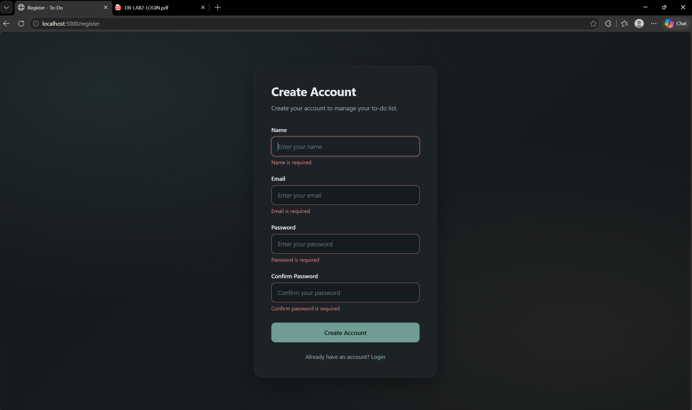
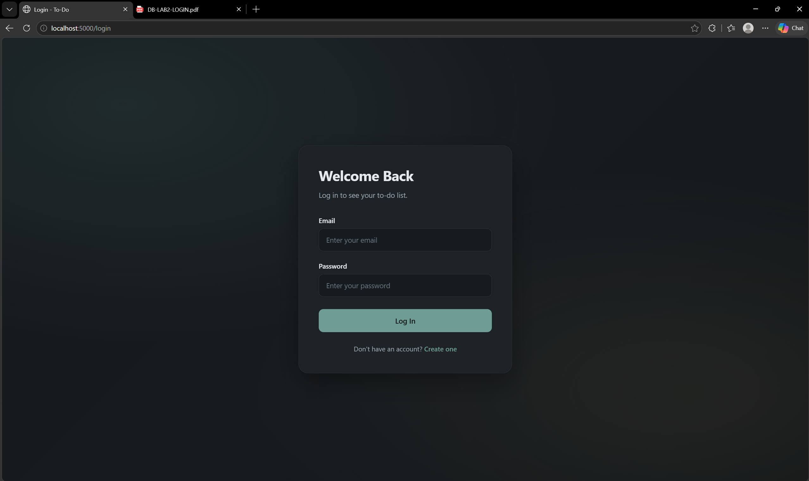
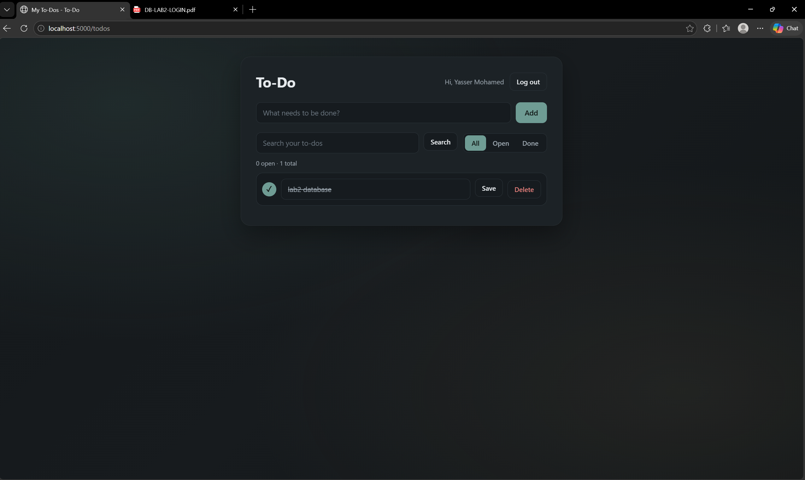
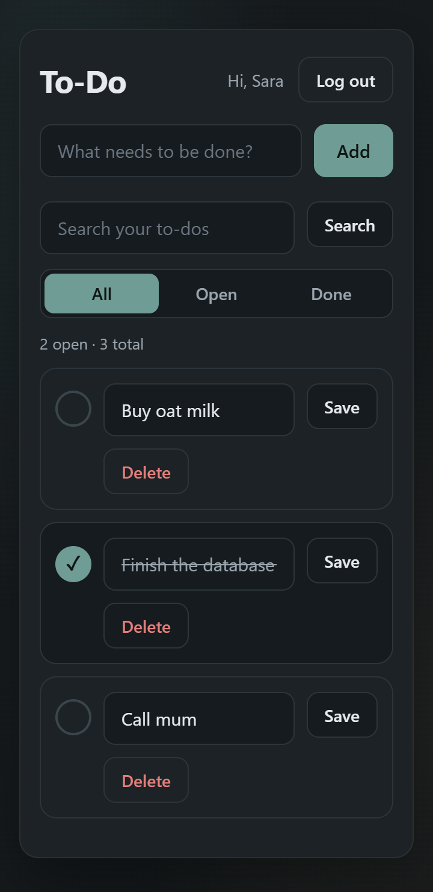
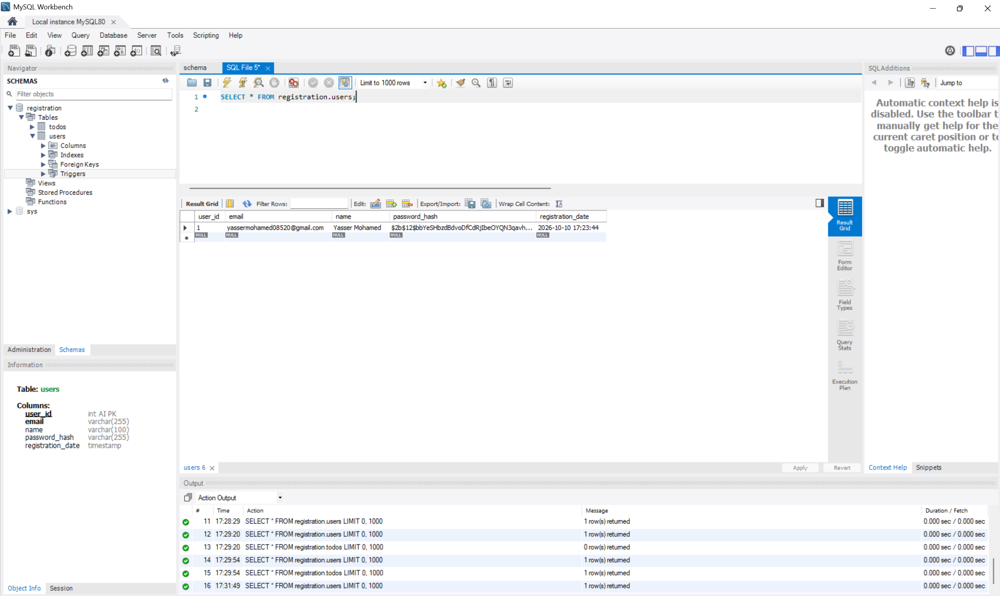

# Lab 2: Login & To-Do Application

Introduction to Database Systems, Alexandria National University, Faculty of Engineering, Fall 2026.

A small web application: sign up, log in, and manage a private to-do list. Flask on the server, MySQL behind it, plain SQL with parameters.

## 1. Team

| Name | ID |
|------|----|
| Yasser Mohamed | 2204157 |
| Adham Ayman | 2204145 |

We worked on this lab together, on the same computer, so all the commits in this repository come from a single GitHub account.

## 2. Technology

| Part | What we used |
|------|--------------|
| Back end | Python 3, Flask, PyMySQL (plain SQL, no ORM), bcrypt, python-dotenv |
| Front end | HTML (Jinja templates), CSS (own CSS, no framework), JavaScript (no library) |
| Database | MySQL 8, database `registration` |

## 3. How to run it (from an empty machine)

You need **Python 3.10+** and **MySQL 8** (with MySQL Workbench or the `mysql` command line).

1. **Get the code**
   ```
   git clone <repository-url>
   cd <repository-folder>
   ```

2. **Create the database.** Run `database/schema.sql` with MySQL Workbench (`File > Open SQL Script`, then the lightning button), or from a terminal:
   ```
   mysql -u root -p < database/schema.sql
   ```
   The script starts with `DROP DATABASE IF EXISTS registration;`, so it can be run again and again (it erases the data each time).

3. **Install the Python packages** (Windows PowerShell):
   ```
   python -m venv venv
   .\venv\Scripts\activate
   pip install -r requirements.txt
   ```
   On macOS / Linux: `source venv/bin/activate` instead of the second line.

4. **Create your `.env` file.** Copy `.env.example` to `.env` and put your own values:
   ```
   copy .env.example .env          (Windows)
   cp .env.example .env            (macOS / Linux)
   ```
   - `DB_USER` and `DB_PASSWORD`: your MySQL user and password.
   - `SECRET_KEY`: any long random text (it signs the session cookie).
   - Leave `DB_HOST`, `DB_PORT` and `DB_NAME` as they are, unless your MySQL runs elsewhere.

5. **Start the server**
   ```
   python app.py
   ```

6. **Open** <http://localhost:5000> in the browser. You are sent to the login page; press *Create one* to register.

## 4. Features

| # | Requirement | Where |
|---|-------------|-------|
| R1 | Register with name, e-mail, password, confirm password. A duplicate e-mail shows `Email Already Exists`. After registering the user is logged in and sees the list. | `app.py` (`/register`) |
| R2 | Login. A wrong e-mail and a wrong password show the same `Invalid email or password`. Logout ends the session. | `app.py` (`/login`, `/logout`) |
| R3 | The list is private: a visitor who is not logged in is sent to the login page. A user sees only their own to-dos, newest first. | `login_required`, `ORDER BY todo_id DESC` |
| R4 | Add a to-do | `/todos/add` |
| R5 | Edit its title | `/todos/<id>/edit` |
| R6 | Mark it done / not done | `/todos/<id>/toggle` |
| R7 | Delete it, after an "are you sure?" question | `/todos/<id>/delete`, `static/todos.js` |
| R8 | Checks in the browser (JavaScript) **and** on the server, with the exact messages of the lab. On a server error the same page is shown again and the database is not touched. | `static/*.js`, `validate_*` in `app.py` |
| R9 | bcrypt hashes (cost 12); only the queries of the lab, always with `%s` parameters; `user_id` always comes from the session. | `app.py` |
| R10 | One consistent style, works at 360 px wide, feedback messages, visible state for done to-dos, a friendly empty state, name and logout button, no raw error pages. | `static/style.css`, `templates/` |

### Extra rules we added

- E-mail must look like `something@something.something`.
- Password: at least 8 characters, one uppercase letter, one lowercase letter and one symbol (at most 72 bytes, the limit of bcrypt).
- The same rules and messages exist in JavaScript and in Python.

### Bonus

- **Filters** (All / Open / Done) and a **search box** for the titles. They are done in Python on the rows returned by the lab's `SELECT`, so no new query was added.
- **Counter** of the open to-dos (`x open · y total`).
- **Dark mode**, following the operating system setting.

### Project structure

```
app.py               the server: routes, validation, bcrypt, SQL
database/schema.sql  DDL of both tables (re-runnable, no data)
templates/           Jinja pages: register, login, todos, error
static/              style.css, register.js, login.js, todos.js
screenshots/         pictures used in this README
.env.example         fake values; copy to .env (never commit .env)
requirements.txt     Python packages
```

## 5. Screenshots

| Register page with error messages | Login page |
|---|---|
|  |  |

| The list with some to-dos (one done) | Phone-sized window (360 px) |
|---|---|
|  |  |

| Hashes in the database |
|---|
|  |

## 6. Answers

**(a) Why do `UPDATE` and `DELETE` contain `AND user_id = ?`, and what changes if you remove it?**

The id of a to-do comes from the browser, so anybody can send a request with somebody else's number. With `AND user_id = ?` (the id of the logged-in user, taken from the session) the statement only matches rows that belong to the current user; for a to-do that is not theirs it changes zero rows. If we remove it, any logged-in user could edit, mark or delete the to-dos of every other user just by changing the number in the request.

**(b) What happens if you insert a to-do for a `user_id` that does not exist, and which constraint of the lecture is that?**

MySQL refuses the `INSERT` with error 1452 (a foreign key constraint fails) and no row is added. This is the **referential integrity** constraint (the foreign key `todos.user_id` references `users.user_id`): every value of the foreign key must be a primary-key value that exists in the referenced table, so a to-do cannot belong to a user that does not exist.

**(c) Why do you store a hash and not the password?**

If the database is ever leaked (or read by an administrator), the passwords must not be readable. A hash cannot be turned back into the password. We use bcrypt because it is salted (two equal passwords give two different hashes, so a precomputed table is useless) and slow on purpose (guessing many passwords is expensive). To log in, the library compares the typed password with the stored hash; we never need the original password.

**(d) The `name` column is `NOT NULL`: why did you still need your own check for an empty name?**

`NOT NULL` only refuses the value `NULL`. An empty text `''` (or a name made of spaces) is a value, so MySQL accepts it. Only our own checks, in JavaScript and again on the server (`name.strip() == ""`), can refuse an empty name and show `Name is required`.
